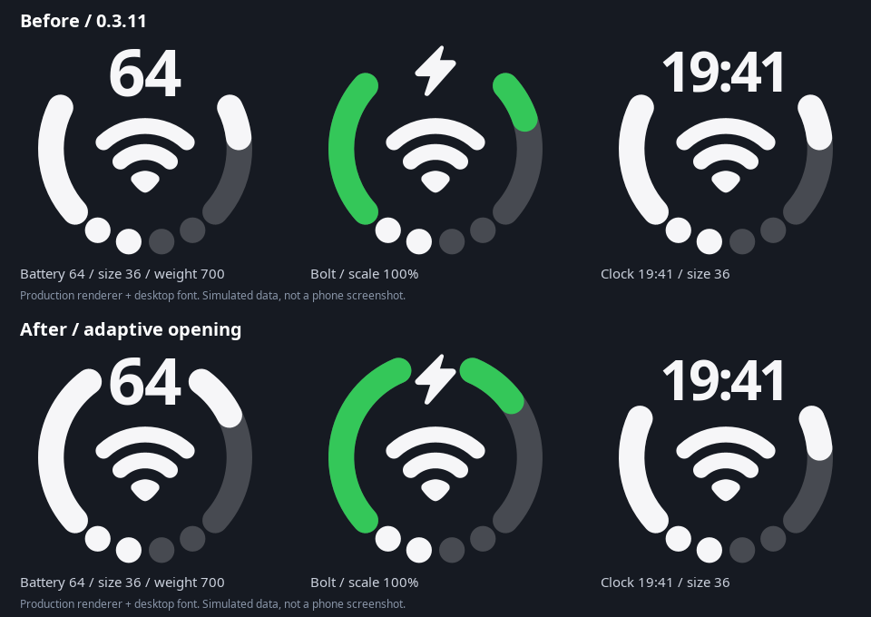

# 0.3.12 圆环开口检查

**0.3.12 / 10032** 使用正式签名，可覆盖升级并保留配置。安装后重启 SystemUI 或手机。

[下载正式版 APK](https://github.com/chorusfruit-233/ColorDuo/releases/download/v0.3.12/ColorDuo-0.3.12.apk)。

圆环上下开口按实际文字和闪电路径的绘制范围调整，并为圆头环线保留间距。信号等级和电量进度含义不变。

1. 选择“圆环”，在上部放置电量数字，调节“数字字号”和“数字字重”，检查环线随实际数字宽度调整，并保留清晰间距。
2. 上部换成充电闪电，选择充电预览状态，调节“充电闪电大小”；再用时间和网络类型作对照。
3. 将相同组件放到下部检查，并确认环线附近的点击区域仍能打开电池设置，开口中间仍能编辑组件。
4. 在真实状态栏检查效果。以下对比由生产绘图代码与桌面字体生成，用于说明几何变化，属于模拟数据，并非实机截图。

